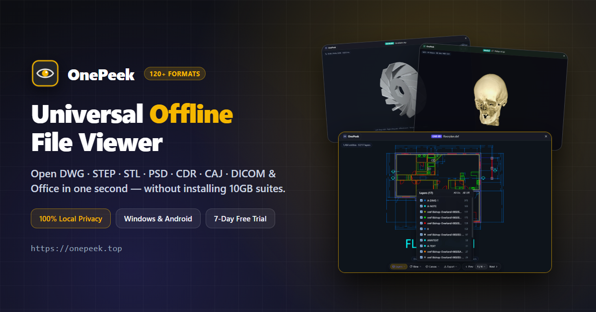
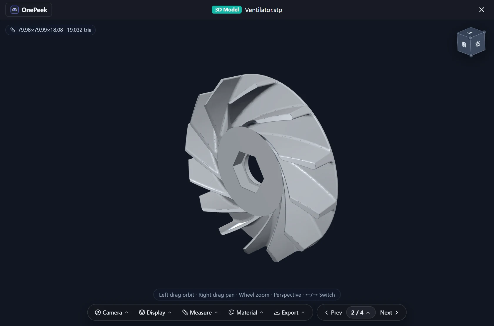
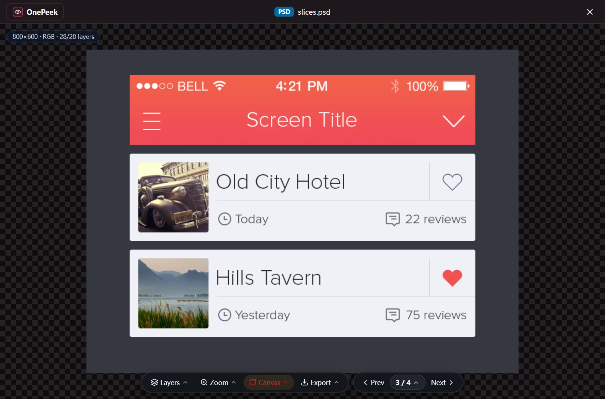

# OnePeek — Offline Universal File Viewer

**Open 120+ file formats offline on Windows & Android — CAD, 3D STEP/STL, CDR/PSD/AI, DICOM/NIfTI, CAJ, PDF, E-books & Office.**

[Website](https://onepeek.top/) · [简体中文](README.zh-CN.md) · [Latest Release (v1.1.3)](https://github.com/Hyuzhe/OnePeek-Viewer/releases/tag/v1.1.3) · [Report a Bug](https://github.com/Hyuzhe/OnePeek-Viewer/issues/new?template=bug_report.md) · [Request a Format](https://github.com/Hyuzhe/OnePeek-Viewer/issues/new?template=format_request.md)

> **Repository Notice:** This public repository hosts OnePeek's official documentation, showcase, verified release links, and public issue tracker. OnePeek is commercial proprietary software; application source code is maintained privately.

---

## Why OnePeek?

- **100% Local & Offline:** Files stay strictly on your device — zero cloud uploads, no account required to view files.
- **Portable & Lightweight (~15 MB):** Runs cleanly without installing heavy 10 GB+ CAD/design suites just to inspect a drawing or model.
- **120+ Engineering, Design, Medical, Academic & Document Formats:** One unified viewer across Windows x64 and Android.
- **Quick Inspection Built In:** Smooth zooming, layer/structure inspection, 3D orbit controls, slice navigation, and fast document rendering.

---

## Real In-App Screenshots

<table>
  <tr>
    <td align="center" width="50%">
       
      <strong>CAD Drawings (DWG / DXF)</strong> 
      Sample: <code>floorplan.dxf</code>
    </td>
    <td align="center" width="50%">
       
      <strong>3D CAD &amp; Meshes (STEP / IGES / STL / GLB)</strong> 
      Sample: <code>Ventilator.stp</code>
    </td>
  </tr>
  <tr>
    <td align="center" width="50%">
       
      <strong>Design &amp; Vector (PSD / CDR / AI)</strong> 
      Sample: <code>slices.psd</code>
    </td>
    <td align="center" width="50%">
       
      <strong>Medical Imaging (DICOM / NIfTI)</strong> 
      Sample: <code>CT_Philips.nii.gz</code>
    </td>
  </tr>
</table>

---

## Supported Format Guides (120+ Formats)

Explore detailed format guides on **[onepeek.top](https://onepeek.top/)**:

| Category | Highlighted Formats & Guides |
| --- | --- |
| **2D / 3D CAD** | [DWG](https://onepeek.top/open/dwg/) · [DXF](https://onepeek.top/open/dxf/) · [STEP / STP](https://onepeek.top/open/stp/) · [IGES / IGS](https://onepeek.top/open/igs/) |
| **3D Models & Printing** | [STL](https://onepeek.top/open/stl/) · [3MF](https://onepeek.top/open/3mf/) · [GLB / glTF](https://onepeek.top/open/glb/) |
| **Graphic & Vector Design** | [CorelDRAW (CDR)](https://onepeek.top/open/cdr/) · [Photoshop (PSD)](https://onepeek.top/open/psd/) · [Illustrator (AI)](https://onepeek.top/open/ai/) |
| **Medical Imaging** | [DICOM (DCM)](https://onepeek.top/open/dcm/) · [NIfTI (NII / NII.GZ)](https://onepeek.top/open/nii/) |
| **Academic & E-Books** | [CAJ](https://onepeek.top/open/caj/) · [PDF](https://onepeek.top/open/pdf/) · [EPUB](https://onepeek.top/open/epub/) · [MOBI](https://onepeek.top/open/mobi/) |
| **Office & Documents** | [Word (DOCX)](https://onepeek.top/open/docx/) · [Excel (XLSX)](https://onepeek.top/open/xlsx/) · [PowerPoint (PPTX)](https://onepeek.top/open/pptx/) |

---

## Download & Checksums (v1.1.3)

| Platform | Package | Size | Direct Download | SHA-256 |
| --- | --- | --- | --- | --- |
| **Windows (x64)** | Portable Single EXE | 15.2 MB (`15955456` bytes) | [OnePeek-1.1.3.exe](https://api.onepeek.top/v1/download/OnePeek-1.1.3.exe) | `dda50fa8e41ab29dde2f5c1fa312ceb8da021f74bfee886db94d90983daef112` |
| **Android** | Universal APK | 15.1 MB (`15871840` bytes) | [OnePeek-Android-1.1.3.apk](https://api.onepeek.top/v1/download/OnePeek-Android-1.1.3.apk) | `ff84b85ef684ec4dde544d9a3319abc19d927caa1e47931caae4338f4b4b84fd` |

### WinGet (Windows Package Manager)

A package submission for `OnePeek.OnePeek` (1.1.3) has been opened at [microsoft/winget-pkgs#487893](https://github.com/microsoft/winget-pkgs/pull/487893). Once merged, you will be able to install via `winget install OnePeek.OnePeek`.

---

## Pricing & Licensing

- **One-time purchase (no subscription):** Personal & multi-seat commercial tiers from **$19** to **$79** on [onepeek.top](https://onepeek.top/).
- **China region pricing:** **$10** to **$49** (approx. ¥70+) with Alipay support on [onepeek.top/zh/](https://onepeek.top/zh/).

---

## Open-Source Sample Attributions

Screenshots above were captured inside OnePeek using publicly available open-source sample files:

- `floorplan.dxf` — [`jscad/sample-files`](https://github.com/jscad/sample-files)
- `Ventilator.stp` — [`tpaviot/pythonocc-demos`](https://github.com/tpaviot/pythonocc-demos)
- `slices.psd` — [`layervault/psd.rb`](https://github.com/layervault/psd.rb)
- `CT_Philips.nii.gz` — [`niivue/niivue-demo-images`](https://github.com/niivue/niivue-demo-images)

---

## Support & Feedback

- **Bug Reports & Crashes:** [Open a Bug Report](https://github.com/Hyuzhe/OnePeek-Viewer/issues/new?template=bug_report.md)
- **Format Requests:** [Request a New Format](https://github.com/Hyuzhe/OnePeek-Viewer/issues/new?template=format_request.md)
- **Email Support & Licensing:** [support@onepeek.top](mailto:support@onepeek.top)
