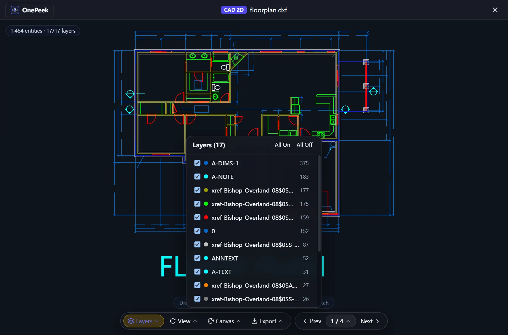
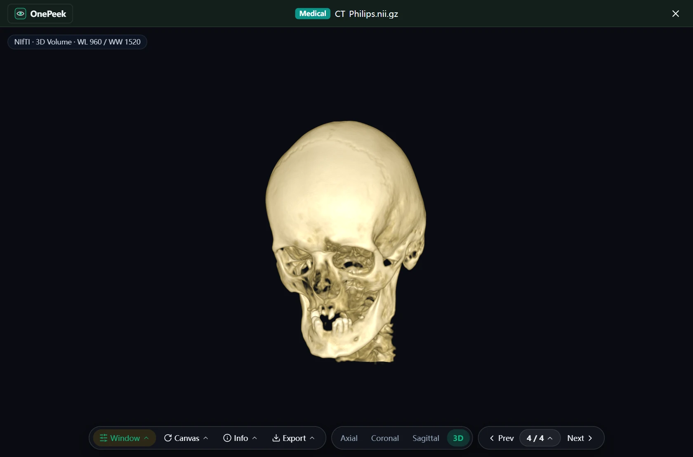

<div align="center">


# OnePeek — Open-Core Universal File Viewer & Windows QuickLook

**Open 120+ file formats offline on Windows & Android. Build the GPLv3 Community Edition from source with Windows Spacebar QuickLook, or download OnePeek Pro for CAD, 3D STEP/STL, CDR/PSD/AI, DICOM/NIfTI, CAJ, eBooks & Office.**

[Website](https://onepeek.top/) · [简体中文](README.zh-CN.md) · [Latest Release (v1.1.3)](https://github.com/Hyuzhe/OnePeek-Viewer/releases/tag/v1.1.3) · [Report a Bug](https://github.com/Hyuzhe/OnePeek-Viewer/issues/new?template=bug_report.md) · [Request a Format](https://github.com/Hyuzhe/OnePeek-Viewer/issues/new?template=format_request.md)

[](https://github.com/Hyuzhe/OnePeek-Viewer/actions/workflows/ci.yml)


</div>

> **Open-Core Model:** This repository contains the full, buildable source code for **OnePeek Community** (Tauri 2 + Rust shell, native Windows Explorer Spacebar QuickLook daemon, and core built-in viewers) licensed under **GNU GPLv3**. Specialized commercial engines for Pro formats (CAD, 3D models, CorelDRAW/PSD/AI, DICOM/NIfTI, CAJ, Office, and e-books) remain proprietary in pre-built **OnePeek Pro** releases.

---

## Community Edition (GPLv3) vs OnePeek Pro

| Capability / Format | OnePeek Community (`GPL-3.0-only`, This Repo) | OnePeek Pro (Commercial Release) |
| --- | :---: | :---: |
| **Tauri 2 + Rust Shell & Dark/Light Themes (6 Palettes)** | Included | Included |
| **Windows Explorer Spacebar QuickLook (`quicklook_daemon.rs` + `shell_explorer.rs`)** | Included | Included |
| **Images & Vector SVG (`JPG`, `PNG`, `WebP`, `GIF`, `SVG`, `AVIF`) + PNG Export** | Included | Included |
| **PDF Reader (`pdfjs-dist`) + HiDPI PNG Export** | Included | Included |
| **Local HTML/XHTML Sandbox (`html_engine.rs`)** | Included | Included |
| **Markdown & 35+ Code Languages (`fs_service.rs`, GBK/UTF-8 Auto-Detect)** | Included | Included |
| **Archives (`ZIP`, `7Z`, `RAR`, `TAR`, `TAR.GZ`) & Range-Streaming Media (`MP4`, `MKV`, `MP3`, `FLAC`)** | Included | Included |
| **Network Stack** | **Zero HTTP/network crates** | Optional online license check & updater |
| **2D / 3D CAD (`DWG`, `DXF`, `STEP/STP`, `IGES/IGS`, `STL`, `3MF`, `GLB`)** | — (Prompts Pro) | Included |
| **Design & Vector (`CDR/CMX`, `PSD/PSB`, `AI`)** | — (Prompts Pro) | Included |
| **Medical Imaging (`DICOM/DCM`, `NIfTI .nii/.nii.gz`, `NRRD`, MPR + 3D)** | — (Prompts Pro) | Included |
| **Academic & Office (`CAJ/KDH/NH`, `EPUB/MOBI/AZW3`, `DOCX`, `XLSX`, `PPTX`)** | — (Prompts Pro) | Included |

---

## Architecture Highlights (Auditable Community Source)

- **100% Air-Gapped by Dependency Graph:** Inspect [`src-tauri/Cargo.toml`](src-tauri/Cargo.toml) and [`src/services/fileBridge.ts`](src/services/fileBridge.ts) — Community Edition compiles with **zero HTTP/network client crates** and zero `fetch()` calls.
- **Native Windows Explorer QuickLook COM Integration:** [`src-tauri/src/quicklook_daemon.rs`](src-tauri/src/quicklook_daemon.rs) and [`src-tauri/src/shell_explorer.rs`](src-tauri/src/shell_explorer.rs) query the active Explorer `IShellWindows` / Desktop `ShellFolderView` selection natively via Win32 COM when Spacebar is pressed, without injecting DLL hooks into `explorer.exe`.
- **Token-Gated Local Range Media Server & Zip/7z/RAR Engine:** [`src-tauri/src/media_server.rs`](src-tauri/src/media_server.rs) streams local video/audio over `127.0.0.1` with ephemeral tokens, while [`src-tauri/src/archive_service.rs`](src-tauri/src/archive_service.rs) supports instant nested browsing inside `ZIP`, `7Z`, `RAR`, and `TAR` archives.

---

## Build Community Edition from Source

### Prerequisites
- **Node.js 20+** and **npm**
- **Rust 1.89+** (`rustup`)
- On Windows: Visual Studio C++ Build Tools + WebView2 Runtime (built into Windows 10/11)

### Commands

```bash
git clone https://github.com/Hyuzhe/OnePeek-Viewer.git
cd OnePeek-Viewer
npm install

# Launch desktop Community Edition in dev mode
npm run tauri dev

# Build production Community desktop binary
npm run build
npm run tauri build

# Run Rust unit tests (encoding, companion lookup, HTML sandbox, archive extraction, autostart, media streaming)
cd src-tauri
cargo test
```

---

## Real In-App Screenshots (OnePeek Pro)

<table>
  <tr>
    <td align="center" width="50%">
      <br />
      <strong>CAD Drawings (DWG / DXF)</strong><br />
      <sub>Sample: <code>floorplan.dxf</code></sub>
    </td>
    <td align="center" width="50%">
      <br />
      <strong>3D CAD &amp; Meshes (STEP / IGES / STL / GLB)</strong><br />
      <sub>Sample: <code>Ventilator.stp</code></sub>
    </td>
  </tr>
  <tr>
    <td align="center" width="50%">
      <br />
      <strong>Design &amp; Vector (PSD / CDR / AI)</strong><br />
      <sub>Sample: <code>slices.psd</code></sub>
    </td>
    <td align="center" width="50%">
      <br />
      <strong>Medical Imaging (DICOM / NIfTI)</strong><br />
      <sub>Sample: <code>CT_Philips.nii.gz</code></sub>
    </td>
  </tr>
</table>

---

## Supported Format Guides (120+ Formats)

Explore detailed format guides on **[onepeek.top](https://onepeek.top/)**:

| Category | Highlighted Formats & Guides |
| --- | --- |
| **2D / 3D CAD** | [DWG](https://onepeek.top/open/dwg/) · [DXF](https://onepeek.top/open/dxf/) · [STEP / STP](https://onepeek.top/open/stp/) · [IGES / IGS](https://onepeek.top/open/igs/) |
| **3D Models & Printing** | [STL](https://onepeek.top/open/stl/) · [3MF](https://onepeek.top/open/3mf/) · [GLB / glTF](https://onepeek.top/open/glb/) |
| **Graphic & Vector Design** | [CorelDRAW (CDR)](https://onepeek.top/open/cdr/) · [Photoshop (PSD)](https://onepeek.top/open/psd/) · [Illustrator (AI)](https://onepeek.top/open/ai/) |
| **Medical Imaging** | [DICOM (DCM)](https://onepeek.top/open/dcm/) · [NIfTI (NII / NII.GZ)](https://onepeek.top/open/nii/) |
| **Academic & E-Books** | [CAJ](https://onepeek.top/open/caj/) · [PDF](https://onepeek.top/open/pdf/) · [EPUB](https://onepeek.top/open/epub/) · [MOBI](https://onepeek.top/open/mobi/) |
| **Office & Documents** | [Word (DOCX)](https://onepeek.top/open/docx/) · [Excel (XLSX)](https://onepeek.top/open/xlsx/) · [PowerPoint (PPTX)](https://onepeek.top/open/pptx/) |

---

## Pre-Built Binary Downloads & Checksums (v1.1.3)

| Platform | Package | Size | Direct Download | SHA-256 |
| --- | --- | --- | --- | --- |
| **Windows (x64)** | Portable Single EXE | 15.2 MB (`15955456` bytes) | [OnePeek-1.1.3.exe](https://api.onepeek.top/v1/download/OnePeek-1.1.3.exe) | `dda50fa8e41ab29dde2f5c1fa312ceb8da021f74bfee886db94d90983daef112` |
| **Android** | Universal APK | 15.1 MB (`15871840` bytes) | [OnePeek-Android-1.1.3.apk](https://api.onepeek.top/v1/download/OnePeek-Android-1.1.3.apk) | `ff84b85ef684ec4dde544d9a3319abc19d927caa1e47931caae4338f4b4b84fd` |

### WinGet (Windows Package Manager)

A package submission for `OnePeek.OnePeek` (1.1.3) is open at [microsoft/winget-pkgs#487893](https://github.com/microsoft/winget-pkgs/pull/487893). Once merged, you can install via `winget install OnePeek.OnePeek`.

---

## Pricing & Licensing

- **OnePeek Community Edition (this repository):** Free and open source under the **GNU General Public License v3.0 (`GPL-3.0-only`)**. See [`LICENSE`](LICENSE).
- **OnePeek Pro Edition (commercial binary releases):** One-time purchase (no recurring subscription) from **\$19** to **\$79** on [onepeek.top](https://onepeek.top/), with regional China pricing **\$10** to **\$49** (approx. ¥70+) via Alipay on [onepeek.top/zh/](https://onepeek.top/zh/). Dual licensing applies: Pro commercial engines and pre-built binaries remain proprietary under commercial terms.

---

## Open-Source Sample Attributions

Screenshots above were captured inside OnePeek using publicly available open-source sample files:

- `floorplan.dxf` — [`jscad/sample-files`](https://github.com/jscad/sample-files)
- `Ventilator.stp` — [`tpaviot/pythonocc-demos`](https://github.com/tpaviot/pythonocc-demos)
- `slices.psd` — [`layervault/psd.rb`](https://github.com/layervault/psd.rb)
- `CT_Philips.nii.gz` — [`niivue/niivue-demo-images`](https://github.com/niivue/niivue-demo-images)

---

## Support & Feedback

- **Bug Reports & Crashes:** [Open a Bug Report](https://github.com/Hyuzhe/OnePeek-Viewer/issues/new?template=bug_report.md)
- **Format Requests:** [Request a New Format](https://github.com/Hyuzhe/OnePeek-Viewer/issues/new?template=format_request.md)
- **Email Support & Licensing:** [support@onepeek.top](mailto:support@onepeek.top)
