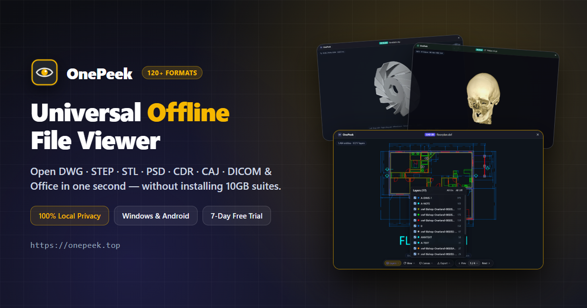
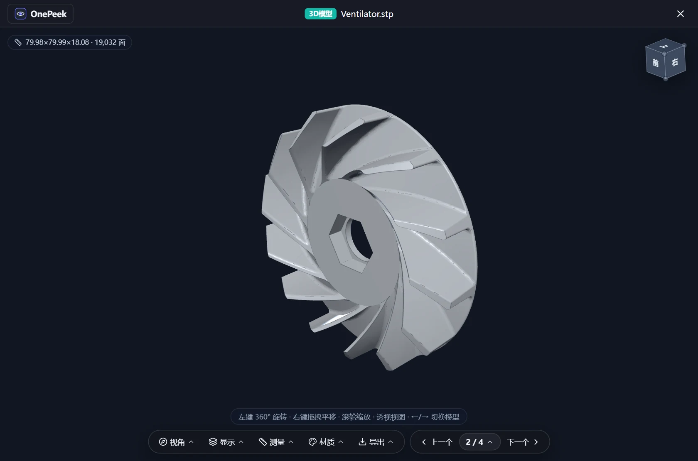
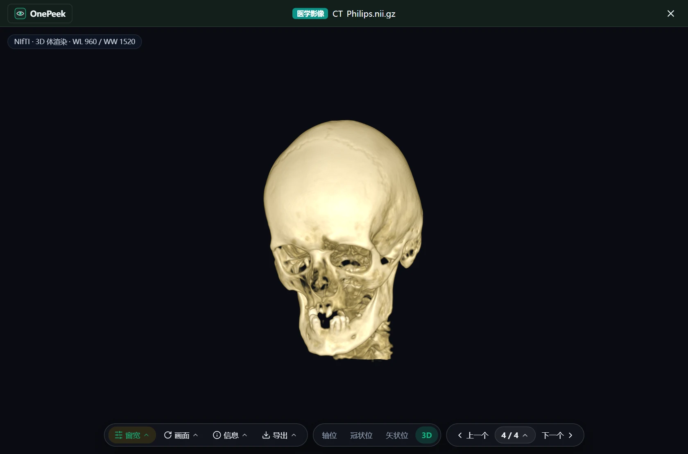

<div align="center">



# OnePeek — Open-Core 离线万能文件查看器与 Windows 空格预览工具

**Windows 与 Android 离线极速打开 120+ 种格式：本仓库以 GNU GPLv3 开源免费社区版完整源码（Tauri 2 + Rust + Windows 空格键 QuickLook + 图片/SVG/PDF/网页/代码/压缩包/音视频）；CAD、三维模型、CDR/PSD/AI、医学影像、CAJ 与 Office 由 OnePeek Pro 商业版提供。**

[官方网站](https://onepeek.top/zh/) · [English](README.md) · [最新版本 (v1.1.3)](https://github.com/Hyuzhe/OnePeek-Viewer/releases/tag/v1.1.3) · [提交 Bug](https://github.com/Hyuzhe/OnePeek-Viewer/issues/new?template=bug_report.md) · [申请支持新格式](https://github.com/Hyuzhe/OnePeek-Viewer/issues/new?template=format_request.md)

[](https://github.com/Hyuzhe/OnePeek-Viewer/actions/workflows/ci.yml)


</div>

> **Open-Core 开源模式说明：** 本公开仓库完整开源 **OnePeek Community 社区版** 可直接从源码编译运行的全部代码（Tauri 2 + Rust 桌面壳、Windows 资源管理器空格键 QuickLook 守护进程及基础内置预览器），采用 **GNU GPLv3** 协议。专业高价值引擎（CAD/DWG、3D STEP/STL、CDR/PSD/AI、DICOM/NIfTI、CAJ、Office、电子书）保留在闭源 **OnePeek Pro** 商业发行版中。

---

## 社区版（GPLv3 开源）与 Pro 商业版对比

| 能力 / 格式支持 | OnePeek Community (`GPL-3.0-only`, 本仓库源码) | OnePeek Pro (预编译商业发行版) |
| --- | :---: | :---: |
| **Tauri 2 + Rust 极速桌面壳 + 6 套主题配色全解锁** | 支持（完整源码） | 支持 |
| **Windows 空格键秒开预览（`quicklook_daemon.rs` + `shell_explorer.rs`）** | 支持（完整源码） | 支持 |
| **常见图片与 SVG 矢量图 (`JPG`, `PNG`, `WebP`, `GIF`, `SVG`, `AVIF`) + PNG 导出** | 支持 | 支持 |
| **PDF 高清阅读器 (`pdfjs-dist`) + 单页导出 PNG** | 支持 | 支持 |
| **本地 HTML/XHTML 沙箱隔离预览（`html_engine.rs`）** | 支持 | 支持 |
| **Markdown 与 35+ 编程语言代码文本（自动识别 GBK / UTF-8 / UTF-16）** | 支持 | 支持 |
| **压缩包 (`ZIP`, `7Z`, `RAR`, `TAR`, `TAR.GZ`) 免解压直看与本地音视频流** | 支持 | 支持 |
| **网络依赖审计** | **零 HTTP / 网络请求 Crate** | 可选联网授权验证与安全更新 |
| **2D / 3D CAD (`DWG`, `DXF`, `STEP/STP`, `IGES/IGS`, `STL`, `3MF`, `GLB`)** | —（引导前往 Pro） | 支持 |
| **平面与矢量源稿 (`CDR/CMX`, `PSD/PSB`, `AI`)** | —（引导前往 Pro） | 支持 |
| **医学影像 (`DICOM/DCM`, `NIfTI .nii/.nii.gz`, `NRRD`, 三视图 + 3D)** | —（引导前往 Pro） | 支持 |
| **学术与办公 (`CAJ/KDH/NH`, `EPUB/MOBI/AZW3`, `Word`, `Excel`, `PPT`)** | —（引导前往 Pro） | 支持 |

---

## 核心技术与隐私架构亮点（可自行审计源码）

- **依赖级物理断网保证：** 检查 [`src-tauri/Cargo.toml`](src-tauri/Cargo.toml) 和 [`src/services/fileBridge.ts`](src/services/fileBridge.ts) 可见，社区版**未引入任何 HTTP/网络客户端 Crate**，前端也零 `fetch()` 调用，从依赖层杜绝后台偷传文件。
- **Windows 原生空格键 QuickLook COM 探测：** [`src-tauri/src/quicklook_daemon.rs`](src-tauri/src/quicklook_daemon.rs) 与 [`src-tauri/src/shell_explorer.rs`](src-tauri/src/shell_explorer.rs) 通过 Win32 COM 查询 `IShellWindows` 与桌面视图选区，不向 `explorer.exe` 注入 DLL 钩子，双击即跑、驻留托盘按空格秒弹。
- **随机令牌保护的本地 Range 媒体流与多格式压缩引擎：** [`src-tauri/src/media_server.rs`](src-tauri/src/media_server.rs) 为视频/音频提供 `127.0.0.1` 令牌校验切片流，[`src-tauri/src/archive_service.rs`](src-tauri/src/archive_service.rs) 支持在 `ZIP`、`7Z`、`RAR`、`TAR` 内层直接点选预览内部文件。

---

## 从源码编译 OnePeek Community 社区版

### 环境要求
- **Node.js 20+** 与 **npm**
- **Rust 1.89+** (`rustup`)
- Windows 需安装 Visual Studio C++ 构建工具及系统自带 WebView2 Runtime

### 构建与测试命令

```bash
git clone https://github.com/Hyuzhe/OnePeek-Viewer.git
cd OnePeek-Viewer
npm install

# 开发模式启动社区版桌面端
npm run tauri dev

# 打包社区版生产二进制文件
npm run build
npm run tauri build

# 运行 Rust 单元测试（文本编码探测、关联纹理路径、HTML 沙箱、压缩包解压、自启快捷方式、媒体流鉴权）
cd src-tauri
cargo test
```

---

## 实机预览截图（OnePeek Pro 渲染效果）

<table>
  <tr>
    <td align="center" width="50%">
      <br />
      <strong>CAD 工程图纸 (DWG / DXF)</strong><br />
      <sub>开源示例：<code>floorplan.dxf</code></sub>
    </td>
    <td align="center" width="50%">
      <br />
      <strong>三维模型与网格 (STEP / IGES / STL / GLB)</strong><br />
      <sub>开源示例：<code>Ventilator.stp</code></sub>
    </td>
  </tr>
  <tr>
    <td align="center" width="50%">
      <br />
      <strong>平面与矢量设计 (PSD / CDR / AI)</strong><br />
      <sub>开源示例：<code>slices.psd</code></sub>
    </td>
    <td align="center" width="50%">
      <br />
      <strong>医学影像 (DICOM / NIfTI)</strong><br />
      <sub>开源示例：<code>CT_Philips.nii.gz</code></sub>
    </td>
  </tr>
</table>

---

## 支持格式指南（120+ 种格式）

点击下方任意格式查看 **[OnePeek 中文官网](https://onepeek.top/zh/)** 对应格式指南：

| 分类 | 常见支持格式 |
| --- | --- |
| **二维 / 三维 CAD** | [DWG](https://onepeek.top/zh/open/dwg/) · [DXF](https://onepeek.top/zh/open/dxf/) · [STEP / STP](https://onepeek.top/zh/open/stp/) · [IGES / IGS](https://onepeek.top/zh/open/igs/) |
| **三维打印与网格** | [STL](https://onepeek.top/zh/open/stl/) · [3MF](https://onepeek.top/zh/open/3mf/) · [GLB / glTF](https://onepeek.top/zh/open/glb/) |
| **设计与矢量源稿** | [CorelDRAW (CDR)](https://onepeek.top/zh/open/cdr/) · [Photoshop (PSD)](https://onepeek.top/zh/open/psd/) · [Illustrator (AI)](https://onepeek.top/zh/open/ai/) |
| **医学影像** | [DICOM (DCM)](https://onepeek.top/zh/open/dcm/) · [NIfTI (NII / NII.GZ)](https://onepeek.top/zh/open/nii/) |
| **学术文献与电子书** | [CAJ](https://onepeek.top/zh/open/caj/) · [PDF](https://onepeek.top/zh/open/pdf/) · [EPUB](https://onepeek.top/zh/open/epub/) · [MOBI](https://onepeek.top/zh/open/mobi/) |
| **Office 办公文档** | [Word (DOCX)](https://onepeek.top/zh/open/docx/) · [Excel (XLSX)](https://onepeek.top/zh/open/xlsx/) · [PowerPoint (PPTX)](https://onepeek.top/zh/open/pptx/) |

---

## 官方预编译安装包与校验 (v1.1.3)

| 平台 | 安装包类型 | 大小 | 官方直链 | SHA-256 校验码 |
| --- | --- | --- | --- | --- |
| **Windows (x64)** | 单文件绿色便携 EXE | 15.2 MB (`15955456` 字节) | [OnePeek-1.1.3.exe](https://api.onepeek.top/v1/download/OnePeek-1.1.3.exe) | `dda50fa8e41ab29dde2f5c1fa312ceb8da021f74bfee886db94d90983daef112` |
| **Android** | 通用安装包 APK | 15.1 MB (`15871840` 字节) | [OnePeek-Android-1.1.3.apk](https://api.onepeek.top/v1/download/OnePeek-Android-1.1.3.apk) | `ff84b85ef684ec4dde544d9a3319abc19d927caa1e47931caae4338f4b4b84fd` |

### WinGet 包管理器

已向微软官方仓库提交 `OnePeek.OnePeek` (1.1.3) 清单 PR：[microsoft/winget-pkgs#487893](https://github.com/microsoft/winget-pkgs/pull/487893)。合并后可直接使用 `winget install OnePeek.OnePeek` 安装。

---

## 开源协议与授权说明

- **OnePeek Community 社区版（本仓库源码）：** 基于 **GNU General Public License v3.0 (`GPL-3.0-only`)** 开源，任何人均可自由研究、编译与二次分发遵循 GPLv3 的衍生作品，详见 [`LICENSE`](LICENSE)。
- **OnePeek Pro 商业版：** 采用商业闭源双授权（Dual Licensing）。中国区买断授权 **\$10** 至 **\$49**（约 **¥70** 起，支持支付宝付款，详见 [onepeek.top/zh/](https://onepeek.top/zh/)）；海外区定价 **\$19** 至 **\$79**，详见 [onepeek.top](https://onepeek.top/)。

---

## 开源示例文件致谢

上述实机截图使用以下开源公开测试文件在 OnePeek 中直接渲染：

- `floorplan.dxf` — [`jscad/sample-files`](https://github.com/jscad/sample-files)
- `Ventilator.stp` — [`tpaviot/pythonocc-demos`](https://github.com/tpaviot/pythonocc-demos)
- `slices.psd` — [`layervault/psd.rb`](https://github.com/layervault/psd.rb)
- `CT_Philips.nii.gz` — [`niivue/niivue-demo-images`](https://github.com/niivue/niivue-demo-images)

---

## 问题反馈与技术支持

- **Bug / 渲染异常 / 崩溃反馈：** [提交 Bug Issue](https://github.com/Hyuzhe/OnePeek-Viewer/issues/new?template=bug_report.md)
- **新格式支持申请：** [提交格式需求 Issue](https://github.com/Hyuzhe/OnePeek-Viewer/issues/new?template=format_request.md)
- **客服与授权邮箱：** [support@onepeek.top](mailto:support@onepeek.top)
