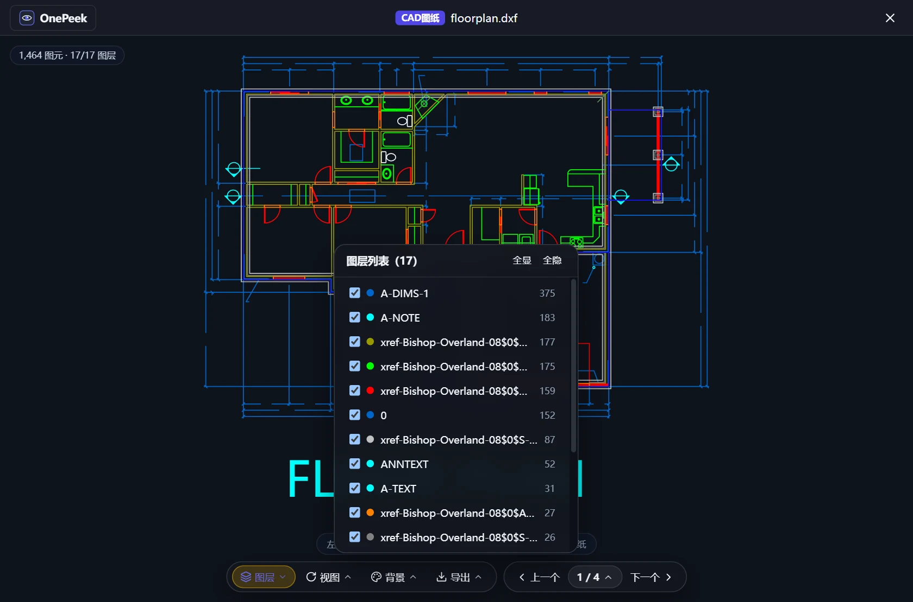
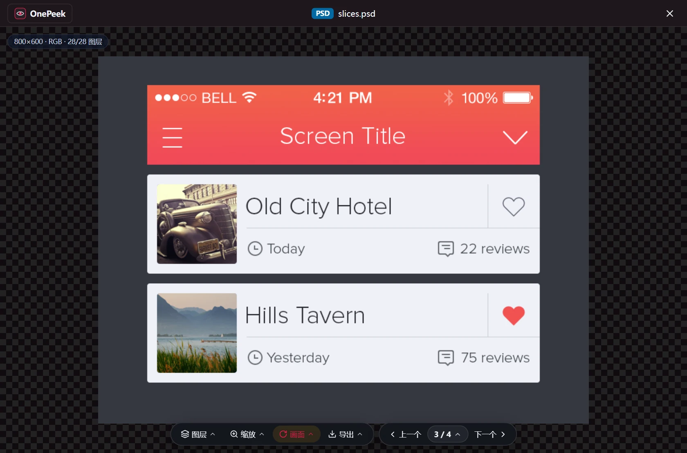

# OnePeek — 轻量级离线万能文件查看器

**Windows 与 Android 离线极速打开 120+ 种专业格式：DWG/DXF 图纸、STEP/STL 三维模型、CDR/PSD/AI 设计稿、DICOM/NIfTI 医学影像、CAJ 文献、PDF 电子书与 Office 文档。**

[官方网站](https://onepeek.top/zh/) · [English](README.md) · [最新版本 (v1.1.3)](https://github.com/Hyuzhe/OnePeek-Viewer/releases/tag/v1.1.3) · [提交 Bug](https://github.com/Hyuzhe/OnePeek-Viewer/issues/new?template=bug_report.md) · [申请支持新格式](https://github.com/Hyuzhe/OnePeek-Viewer/issues/new?template=format_request.md)

> **仓库说明：** 本公开仓库用于发布 OnePeek 的官方文档、实机效果展示、官方下载地址与 SHA-256 校验值，以及公开问题/格式需求反馈追踪。OnePeek 为商业软件，客户端源码不在此仓库公开。

---

## 核心特性

- **100% 本地离线运行：** 所有文件仅在本地设备解析渲染，绝不上传任何服务器，无需注册登录即可看图看文档。
- **单文件便携轻量（约 15 MB）：** 无需动辄数 GB 的大型 CAD/Adobe 专业套件，双击秒开图纸与模型。
- **覆盖 120+ 专业与日常格式：** 一款工具同时覆盖 Windows x64 桌面端与 Android 移动端。
- **专为快速审阅打造：** 支持 CAD 缩放平移、三维模型旋转观察、医学影像切片浏览及设计稿/学术文献快速阅读。

---

## 实机预览截图

<table>
  <tr>
    <td align="center" width="50%">
       
      <strong>CAD 工程图纸 (DWG / DXF)</strong> 
      开源示例：<code>floorplan.dxf</code>
    </td>
    <td align="center" width="50%">
       
      <strong>三维模型与网格 (STEP / IGES / STL / GLB)</strong> 
      开源示例：<code>Ventilator.stp</code>
    </td>
  </tr>
  <tr>
    <td align="center" width="50%">
       
      <strong>平面与矢量设计 (PSD / CDR / AI)</strong> 
      开源示例：<code>slices.psd</code>
    </td>
    <td align="center" width="50%">
       
      <strong>医学影像 (DICOM / NIfTI)</strong> 
      开源示例：<code>CT_Philips.nii.gz</code>
    </td>
  </tr>
</table>

---

## 支持格式指南（120+ 种格式）

点击下方任意格式查看 **[OnePeek 中文官网](https://onepeek.top/zh/)** 对应格式指南：

| 分类 | 常见支持格式 |
| --- | --- |
| **二维 / 三维 CAD** | [DWG](https://onepeek.top/zh/open/dwg/) · [DXF](https://onepeek.top/zh/open/dxf/) · [STEP / STP](https://onepeek.top/zh/open/stp/) · [IGES / IGS](https://onepeek.top/zh/open/igs/) |
| **三维打印与网格** | [STL](https://onepeek.top/zh/open/stl/) · [3MF](https://onepeek.top/zh/open/3mf/) · [GLB / glTF](https://onepeek.top/zh/open/glb/) |
| **设计与矢量源稿** | [CorelDRAW (CDR)](https://onepeek.top/zh/open/cdr/) · [Photoshop (PSD)](https://onepeek.top/zh/open/psd/) · [Illustrator (AI)](https://onepeek.top/zh/open/ai/) |
| **医学影像** | [DICOM (DCM)](https://onepeek.top/zh/open/dcm/) · [NIfTI (NII / NII.GZ)](https://onepeek.top/zh/open/nii/) |
| **学术文献与电子书** | [CAJ](https://onepeek.top/zh/open/caj/) · [PDF](https://onepeek.top/zh/open/pdf/) · [EPUB](https://onepeek.top/zh/open/epub/) · [MOBI](https://onepeek.top/zh/open/mobi/) |
| **Office 办公文档** | [Word (DOCX)](https://onepeek.top/zh/open/docx/) · [Excel (XLSX)](https://onepeek.top/zh/open/xlsx/) · [PowerPoint (PPTX)](https://onepeek.top/zh/open/pptx/) |

---

## 官方下载与校验 (v1.1.3)

| 平台 | 安装包类型 | 大小 | 官方直链 | SHA-256 校验码 |
| --- | --- | --- | --- | --- |
| **Windows (x64)** | 单文件绿色便携 EXE | 15.2 MB (`15955456` 字节) | [OnePeek-1.1.3.exe](https://api.onepeek.top/v1/download/OnePeek-1.1.3.exe) | `dda50fa8e41ab29dde2f5c1fa312ceb8da021f74bfee886db94d90983daef112` |
| **Android** | 通用安装包 APK | 15.1 MB (`15871840` 字节) | [OnePeek-Android-1.1.3.apk](https://api.onepeek.top/v1/download/OnePeek-Android-1.1.3.apk) | `ff84b85ef684ec4dde544d9a3319abc19d927caa1e47931caae4338f4b4b84fd` |

### WinGet 包管理器

已向微软官方仓库提交 `OnePeek.OnePeek` (1.1.3) 清单 PR：[microsoft/winget-pkgs#487893](https://github.com/microsoft/winget-pkgs/pull/487893)。合并后可直接使用 `winget install OnePeek.OnePeek` 安装。

---

## 授权与定价说明

- **中国区买断授权（无订阅年费）：** **$10** 至 **$49**（约 **¥70** 起），支持支付宝付款，详见 [onepeek.top/zh/](https://onepeek.top/zh/)。
- **海外区定价：** **$19** 至 **$79**，详见 [onepeek.top](https://onepeek.top/)。

---

## 开源示例文件致谢

上述实机截图使用以下开源公开测试文件在 OnePeek 中直接渲染：

- `floorplan.dxf` — [`jscad/sample-files`](https://github.com/jscad/sample-files)
- `Ventilator.stp` — [`tpaviot/pythonocc-demos`](https://github.com/tpaviot/pythonocc-demos)
- `slices.psd` — [`layervault/psd.rb`](https://github.com/layervault/psd.rb)
- `CT_Philips.nii.gz` — [`niivue/niivue-demo-images`](https://github.com/niivue/niivue-demo-images)

---

## 问题反馈与技术支持

- **Bug / 渲染异常 / 崩溃反馈：** [提交 Bug Issue](https://github.com/Hyuzhe/OnePeek-Viewer/issues/new?template=bug_report.md)
- **新格式支持申请：** [提交格式需求 Issue](https://github.com/Hyuzhe/OnePeek-Viewer/issues/new?template=format_request.md)
- **客服与授权邮箱：** [support@onepeek.top](mailto:support@onepeek.top)
